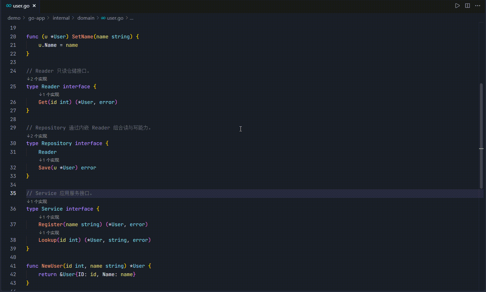

# Gopher Nav

VS Code 扩展，提供与 GoLand 对等的 Go **接口导航**体验。内置 Go 词法/语法解析器与项目级符号索引，接口相关能力**不依赖 gopls**：

- **接口实现查找**：点击接口/接口方法列出全部实现的结构体与方法，一键跳转；接口行与接口方法行显示 GoLand 风格的 `N 个实现` 跳转按钮（CodeLens）。
- **反向查找**：结构体/方法上方显示 `实现 N 个接口`，点击可查看它满足了哪些接口。
- **互跳**：在实现列表/接口列表中点击即可在接口、结构体、方法之间跳转。

> 本扩展**不注册 DefinitionProvider**，F12 / Ctrl+点击的定义跳转完全交由 VS Code 原生 + gopls；两者结果不会再被合并成 peek 列表。

兼容 VS Code **1.80+**，适用于 `go module` 管理的标准 Go 项目。

## 使用演示



点击接口上方的 `↓ N 个实现` 展开实现列表；跳到结构体后可反向查看它实现了哪些接口，再点击回到接口定义。

---

## 1. 项目结构

```
.
├── package.json              # 扩展清单：命令、右键菜单、CodeLens、配置项
├── tsconfig.json
├── .vscode/
│   ├── launch.json           # F5 调试配置（默认打开 demo/go-app）
│   └── tasks.json            # 编译任务
├── src/
│   ├── extension.ts          # 激活入口，注册 Implementation Provider / CodeLens / 命令
│   ├── commands.ts           # 「查找所有实现」等命令与 QuickPick
│   ├── go/                   # 纯 TS 实现，不依赖 vscode，可单独测试
│   │   ├── model.ts          # 索引数据模型（接口、结构体、方法、调用点…）
│   │   ├── lexer.ts          # Go 词法分析（注释/字符串/换行分号语义）
│   │   ├── parser.ts         # 声明解析、函数体调用点与局部类型推断
│   │   ├── index.ts          # 项目索引、跨包解析、接口实现匹配、定义解析
│   │   └── text.ts           # 偏移量/行号与哈希工具
│   └── vscode/
│       ├── service.ts        # 工作区文件发现、go.mod 解析、文件监听、增量索引
│       ├── providers.ts      # Implementation Provider
│       ├── codeLens.ts       # 「N 个实现」跳转按钮
│       └── convert.ts        # 内部位置 → vscode.Location
└── demo/go-app/              # 可直接用于验证的示例 Go module
```

---

## 2. 本地调试运行

### 环境要求

- Node.js 18+
- VS Code 1.80 及以上

### 启动步骤

```bash
npm install
npm run compile     # 或 npm run watch 持续编译
```

1. 用 VS Code 打开本目录（扩展工程根目录）。
2. 按 `F5`，选择 **Run Gopher Nav Extension**。
3. 会启动一个「扩展开发宿主」窗口，并自动打开 `demo/go-app`（由 `.vscode/launch.json` 的 `args` 指定）。
4. 在宿主窗口打开任意 `.go` 文件，右下角状态栏出现 `✓ Go 导航: N 个文件` 即索引完成。

> 调试其它项目：把 `.vscode/launch.json` 中第二个 `args` 改为你的 Go 项目绝对路径；或在宿主窗口中直接「打开文件夹」选择任意含 `go.mod` 的项目。

### 在 demo 项目中验证

打开 `demo/go-app/internal/domain/user.go`：

| 验证点 | 操作 | 预期 |
| --- | --- | --- |
| 接口实现按钮 | 查看 `type Repository interface` 行上方 | 显示 `↓ 2 个实现`，点击弹出 `MemoryRepo`、`AuditRepo`，可跳转 |
| 接口方法按钮 | 查看 `Get(id int)` / `Save(u *User) error` 行上方 | 显示 `↓ N 个实现` |
| 结构体反向查找 | 查看 `demo/go-app/internal/store/memory.go` 的 `type MemoryRepo struct` | 显示 `↑ 实现 2 个接口`（Reader、Repository） |
| 右键菜单 | 在接口名上右键 → **查找所有实现** | 弹出实现列表 |
| 内嵌实现 | 对 `Repository` 查看实现列表 | `AuditRepo` 通过内嵌 `*MemoryRepo` 复用方法，也被识别为实现 |

> F12 / Ctrl+点击的定义跳转由 gopls 提供，本扩展不参与，也不在 demo 验证范围内。

`demo/go-app` 无第三方依赖，可直接 `cd demo/go-app && go run ./cmd`（可选，仅用于确认示例代码可编译）。

---

## 3. 命令与配置

### 命令（命令面板输入 `Gopher Nav` 或 `goNavigator`）

| 命令 | 说明 |
| --- | --- |
| `Gopher Nav: 查找所有实现` | 对光标所在接口、接口方法或实现方法列出实现/对应接口 |
| `Gopher Nav: 查看实现列表` | CodeLens 使用的内部命令（也可手动调用） |
| `Gopher Nav: 查看实现的接口` | 结构体/方法 → 接口列表 |
| `Gopher Nav: 重建 Go 索引` | 手动重建全量索引（状态栏同样可点击触发） |

右键菜单（仅 Go 文件）：`查找所有实现`。

### 设置

| 配置项 | 默认值 | 说明 |
| --- | --- | --- |
| `goNavigator.enableCodeLens` | `true` | 是否显示「N 个实现」跳转按钮 |
| `goNavigator.indexVendor` | `false` | 是否索引 `vendor/` 目录 |
| `goNavigator.maxFileSizeKB` | `2048` | 单文件索引体积上限，避免超大生成文件 |
| `goNavigator.exclude` | `["**/node_modules/**","**/.git/**"]` | 额外排除的 glob |

修改 `indexVendor` / `exclude` / `maxFileSizeKB` 会自动触发重建索引。

---

## 4. 实现原理

### 解析层（零依赖）

- `lexer.ts` 手写 Go 词法分析：跳过注释、正确处理原始字符串/字符字面量，并保留 token 前的换行信息以还原 Go 的**分号插入**语义，从而准确切分结构体字段、接口方法与语句。
- `parser.ts` 只解析导航所需的结构：`package`、`import`（含别名）、类型声明（interface/struct/别名/泛型）、函数与方法签名、结构体内嵌字段、接口内嵌与类型集；函数体则做轻量扫描，记录：
  - 调用点（`f()`、`pkg.F()`、`x.M()`、`s.repo.M()`）
  - 局部变量类型（`var x T`、`x := T{}`、`x := &T{}`、`x := NewT()`、`new(T)`）
  - 复合字面量中的类型引用

### 索引与解析（index.ts）

- `go.mod` 的 `module` 路径 + 目录后缀匹配，把 `import` 映射到工作区目录，实现**跨包**符号解析（含 `vendor` 回退）。
- 接口实现判定基于**方法集**：
  - 自身方法 + 内嵌接口方法 + 内嵌结构体提升方法（递归合并）；
  - 签名比较前做**类型规范化**，把 `*User`（domain 包内）与 `*domain.User`（其它包）归一为同一目标，并把 `func(ctx T)` 的参数名剔除，避免误判。
- 调用点解析优先级：局部变量/参数/接收者类型 → 字段链路逐级解析 → 构造函数返回值 → 全局同名符号兜底（先按实参个数、再用可解析的实参类型过滤候选）。定义跳转（F12）不对外注册，由 gopls 负责。
- 接口/方法/结构体支持双向查询：实现列表、对应接口列表。

### 性能设计

- 激活后在后台分批解析（每批 64 个文件并让出事件循环），状态栏展示进度。
- 目录级 `类型索引` 与 `方法索引` 避免重复扫描同包文件。
- 接口实现结果、方法集、签名规范化结果全部**按索引版本缓存**。
- 文件保存/修改后仅重解析该文件（200ms 防抖），未保存内容也参与导航。
- 性能基准（600 个文件、600 个接口、单包极端场景）：

  ```
  建立索引：30ms（0.05ms/文件）
  单次调用点解析：<1ms
  接口实现查询：冷启动 17ms / 缓存命中 0ms
  CodeLens 全量计算：6.1ms/接口
  ```

  常规项目中导航请求均远低于 500ms。

---

## 5. 已知限制

- 仅索引当前工作区内的 `.go` 文件；标准库与未放入工作区的第三方模块（如 `$GOPATH/pkg/mod`）不参与跳转。需要时可将依赖放入 `vendor/` 并开启 `indexVendor`。
- 类型推断为静态启发式而非完整类型检查：多层链式返回值（`a.B().C()`）、接口断言、复杂泛型实例化等场景可能回退为「按签名过滤后的同名符号列表」。
- F12 / Ctrl+点击的定义跳转由 gopls 提供；未安装 Go 官方扩展时无法跳转定义，但不影响接口实现查找与互跳。
- 仅含类型集约束的接口（如 `interface{ ~int | ~float64 }`）不会把基础类型列为「实现」。
- 不索引结构体字段访问（`c.Name`）的跳转，聚焦接口/方法/类型导航。

---

## 6. 打包（可选）

```bash
npx @vscode/vsce package
```

生成的 `.vsix` 可直接安装到 VS Code 1.80+。
